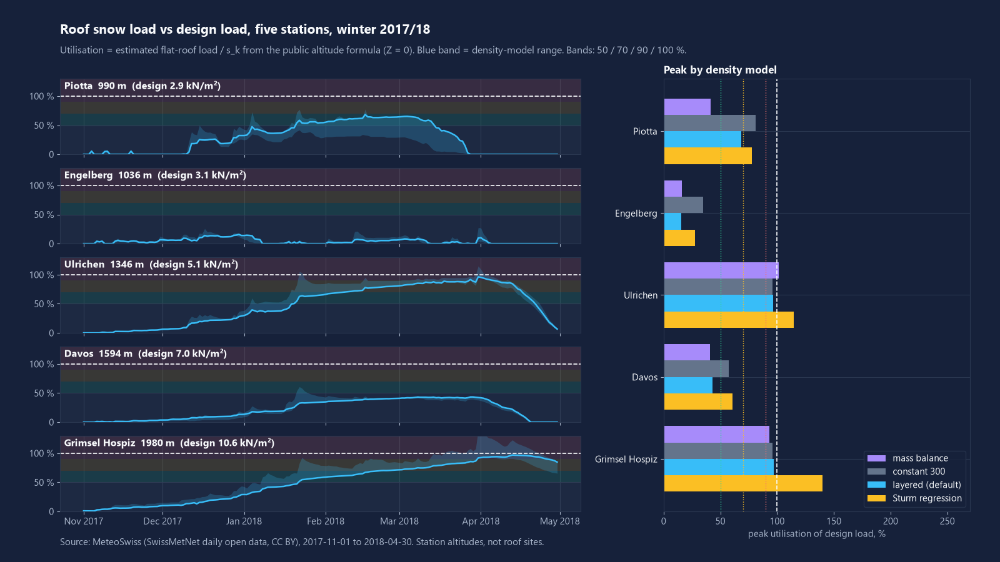
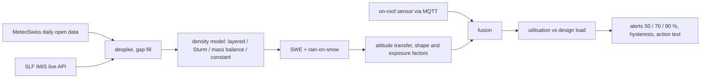

# roof-snow-load-estimator

Open-source roof snow-load monitor: open Swiss snow-station data in, flat-roof load, share of the design load and alerts out.



<sub>Winter 2017/18, MeteoSwiss daily data. Line = default density model, blue band = range across density models, dashed = design load (public altitude formula, Z = 0). Station altitudes, not real roof sites.</sub>

## What it does

- Reads open snow depth, precipitation and temperature (MeteoSwiss daily archive; SLF IMIS live API for current values).
- Converts snow depth to snow water equivalent (SWE) with four documented density models and reports the load in kN/m2.
- Adds a rain-on-snow term, an altitude transfer from station to site, roof shape and exposure coefficients.
- Compares with a design load (public altitude formula, or a value you supply) and raises alerts at 50 / 70 / 90 % with hysteresis and a recommended action.
- Optional on-roof sensor (load cell or depth sensor) via MQTT JSON, fused with the station model.

## Results

All numbers are from `python -m roofsnow demo` on cached MeteoSwiss data (CC BY). Flat roof, normal exposure, Z = 0, no altitude transfer (roof at station altitude). Daily values, 6 UTC snow depth, 181 days per winter (1 Nov to 30 Apr).

Winter 2017/18 (1 Nov 2017 to 30 Apr 2018), default `layered` model:

| Station | Altitude | Max depth | Design load | Peak load | Peak utilisation | Peak day | Days >= 50 / 70 / 90 % |
|---|---|---|---|---|---|---|---|
| Piotta | 990 m | 99 cm | 2.9 kN/m2 | 2.0 kN/m2 | 68 % | 2018-02-16 | 53 / 0 / 0 |
| Engelberg | 1036 m | 46 cm | 3.1 kN/m2 | 0.5 kN/m2 | 16 % | 2017-12-30 | 0 / 0 / 0 |
| Ulrichen | 1346 m | 206 cm | 5.1 kN/m2 | 4.9 kN/m2 | 96 % | 2018-03-31 | 92 / 68 / 7 |
| Davos | 1594 m | 170 cm | 7.0 kN/m2 | 3.0 kN/m2 | 43 % | 2018-03-29 | 0 / 0 / 0 |
| Grimsel Hospiz | 1980 m | 430 cm | 10.6 kN/m2 | 10.2 kN/m2 | 97 % | 2018-04-13 | 99 / 68 / 26 |

Peak utilisation per winter, default model, with the conservative Sturm regression in brackets:

| Station | 2017/18 | 2018/19 | 2020/21 |
|---|---|---|---|
| Piotta | 68 % (78 %) | 11 % (23 %) | 76 % (98 %) |
| Engelberg | 16 % (28 %) | 38 % (65 %) | 43 % (63 %) |
| Ulrichen | 96 % (115 %) | 59 % (76 %) | 68 % (100 %) |
| Davos | 43 % (61 %) | 43 % (56 %) | 38 % (49 %) |
| Grimsel Hospiz | 97 % (140 %) | 65 % (102 %) | 79 % (118 %) |

Across the 15 station-winters: 199 station-days at or above 70 % of design (default model). Hysteresis (5 points) cut alert level changes from 27 to 23 on daily data.

**Model sensitivity (Ulrichen 2017/18, peak utilisation):** constant 400 kg/m3 128 %, Sturm regression 115 %, mass balance 101 %, layered 96 %, constant 300 kg/m3 96 %, constant 200 kg/m3 64 %. The choice of density model changes the peak load by a factor of 2.0. This uncertainty is larger than any other term in the tool, so the figures show the range. Full tables: [docs/results.md](docs/results.md).

**Cross-check, not validation:** the `layered` SWE (depth + temperature) and the `mass_balance` SWE (precipitation + temperature) are independent enough to compare. Correlation is 0.93 to 0.99 at Ulrichen, Grimsel and Davos in 8 of 15 station-winters, and 0.31 to 0.74 at Piotta and Engelberg, where shallow, repeatedly melting snow breaks the simple degree-day assumption. Bias ranges from -51 % to +41 %. Where the two disagree, the load estimate is weak.

**Simulated sensor fusion (no real sensor):** 5 % noise on a synthetic roof sensor, Engelberg 2020/21 (98 days): synthetic truth follows the Sturm regression; RMSE 0.26 kN/m2 for the layered station model, 0.034 for the sensor alone, 0.051 fused. A trusted sensor beats the model; fusion keeps a usable estimate when the sensor drops out.

## Quick start

```bash
pip install -e ".[dev]"           # add ,mqtt for the on-roof sensor listener
python -m roofsnow demo           # offline: tables, docs/figure.png, docs/post-figure.png
python -m roofsnow sk 1346 --z 0  # design load from altitude
python -m roofsnow analyze ULR --winter 2017/18 --model layered
python -m roofsnow analyze ULR --site-alt 1500 --design 4.0   # move to a site, own design load
python -m roofsnow fetch DAV 2019-01-01 2019-04-30 --out dav.csv   # any MeteoSwiss station
python -m roofsnow live DAV2 --design 8.0                     # current SLF IMIS value
python -m roofsnow listen --host localhost --topic roof/load --design 4.0
```

Sensor payload (MQTT JSON): `{"load_kn_m2": 2.4}`, `{"load_kg_m2": 245}` or `{"depth_cm": 80}`, optional `"ts"` and `"sigma_rel"`.

## How it works



- **Density models** (`roofsnow/density.py`): `layered` (default) puts new snow in at the Hedstrom and Pomeroy (1998) fresh density and densifies layers toward 450 kg/m3 with a 30-day time constant (assumed, not calibrated). `sturm` is the Alpine class regression of Sturm et al. (2010, J. Hydrometeorology 11, 1380-1394, Eq. 6 and Table 4, with the paper's season day: -92 on 1 October, +1 on 1 January), the highest of the three dynamic models here. `mass_balance` is a precipitation and degree-day model (factor 4 mm/K/day, range after Hock 2003). `constant` is a fixed density.
- **Rain-on-snow**: rain above 1 degree C on an existing pack is held up to 5 % of SWE and drains 50 % per day (assumptions).
- **Station to site**: snow mass scaled by +6 % per 100 m altitude difference (assumption), limited to 500 m.
- **Design load**: s_k = 0.4 (1 + (h0/350)^2) kN/m2, at least 0.9, h0 = altitude + Z, valid to 2000 m; roof factors mu1 (0.8 up to 30 degrees pitch), Ce (0.8 / 1.0 / 1.2) in the style of EN 1991-1-3. The map of Z values belongs to a copyrighted standard and is not included: you supply Z, or override the design load directly.
- **Alerts**: levels rise immediately and fall only when utilisation is 5 points below the threshold. Utilisation = roof load / design load.

## Data sources

- MeteoSwiss, SwissMetNet automatic stations, daily snow depth (`htoautd0`, 6 UTC), precipitation (`rre150d0`), temperature (`tre200d0`). Open government data, licence CC BY as listed in the collection `ch.meteoschweiz.ogd-smn` on data.geo.admin.ch. Source: MeteoSwiss. Cached in `roofsnow/data/smn_winters.csv` (5 stations x 3 winters, fetched 2026-11-08, rebuild with `roofsnow.data.build_fixture`). Station altitudes from MeteoSwiss station metadata.
- SLF IMIS public measurement API (`measurement-api.slf.ch`), used only by the `live` command. It serves only the last 1, 3 or 7 days (checked 2026-11-08), so it cannot supply the archive. Follow the SLF data terms of use (https://www.slf.ch/en/services-and-products/slf-data-service); no IMIS data is committed here.
- Ground snow load formula (SIA 261:2014): public description at https://de.wikipedia.org/wiki/Schneelast_in_der_Schweiz, cross-checked against a published Zurich building-appeal decision (BRGE IV Nr. 0169/2013) that applies the same formula and the 0.9 kN/m2 minimum. Not checked against the standard text itself (paywalled).
- Literature: Sturm et al. 2010; Hedstrom and Pomeroy 1998; Hock 2003; EN 1991-1-3.

## What is not verified yet

- No validation against measured SWE. No published SWE series was used, so density models are compared with each other, not with truth.
- No real roof, load cell or MQTT broker was used; the sensor listener and fusion are tested only with synthetic payloads.
- Sturm coefficients and the day-of-season convention were checked against the paper (2026-11-09); an earlier version counted days from 1 October and overstated the Sturm loads. Layer time constant, degree-day factor, undercatch, rain retention and altitude gradient are assumptions, not fitted.
- Design load uses Z = 0 for every station. Real Z values differ by location, and the public formula is documented only to 2000 m, so utilisation figures are not code checks.
- Station sites are valley or pass stations, not roofs. Wind drifting, parapets, roof steps, sliding and clearing are not modelled; Ct = 1.
- Daily data only: the 6 UTC depth misses intraday peaks, and precipitation is a 6-to-6 UTC total.
- Isolated depth outliers of more than 50 cm from the 5-day median are dropped as glitches. Real events of that shape would also be dropped.
- Not an engineering tool. Consult a structural engineer for any decision about a real roof.

## Licence

MIT, Copyright (c) 2026 Victor Bonilla.
